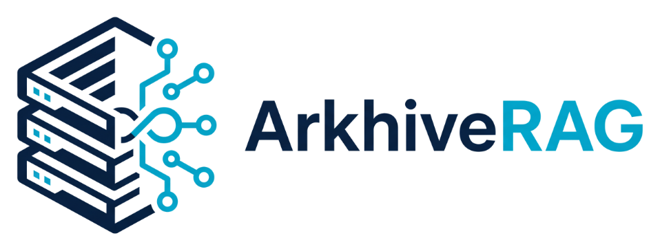
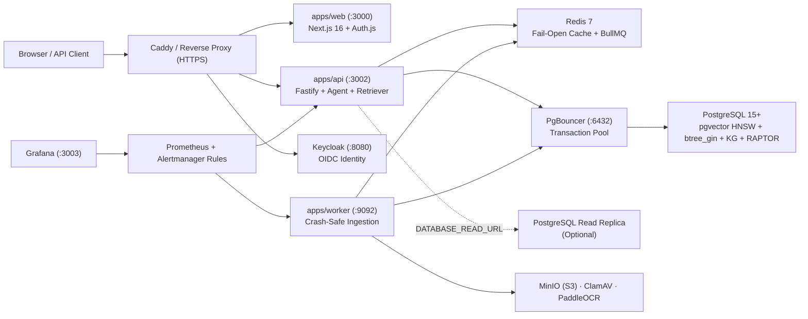

<div align="center">

<picture>
  <source media="(prefers-color-scheme: dark)" srcset="docs/assets/arkhiverag-logo-dark.png" />
  <source media="(prefers-color-scheme: light)" srcset="docs/assets/arkhiverag-logo.png" />
  
</picture>

### Multi-Tenant BYOK Enterprise Adaptive RAG & RBAC Company Agent on PostgreSQL + pgvector

[](https://github.com/aditbap/rag/actions/workflows/ci.yml)
[](CHANGELOG.md)
[](tsconfig.base.json)
[](.nvmrc)
[](docs/ARCHITECTURE.md)
[](apps/web/README.md)
[](apps/api/README.md)
[](infra/README.md)
[](LICENSE)

**Upload documents. Enforce workspace RBAC. Get cited, policy-aware answers.**

ArkhiveRAG unifies hybrid `pgvector` HNSW search, PostgreSQL-native Knowledge Graphs, temporal policy governance, and a bounded RBAC Company Agent into one open-source, Bring-Your-Own-Key (BYOK) platform — with **no separate vector database or graph cluster required**.

[Beyond Traditional RAG](#beyond-traditional-rag) · [Benchmarks](#verified-benchmarks) · [Features](#features) · [Architecture](#architecture) · [BYOK Providers](#bring-your-own-api-key-byok) · [Quick Start](#quick-start) · [API](#api-overview) · [Docs](#documentation--community)

</div>

---

## Beyond Traditional RAG

Most RAG stacks stop at fixed-size chunking and cosine similarity, forcing teams to manage separate vector databases, graph databases, and search clusters. ArkhiveRAG consolidates the entire retrieval, knowledge-graph, and governance pipeline inside PostgreSQL:

| Aspect | Traditional RAG | ArkhiveRAG |
|---|---|---|
| **Infrastructure Stack** | Separate vector DB + graph DB + search engine | **Single PostgreSQL 15+ stack** (`pgvector` HNSW + `btree_gin` FTS + `pg_trgm` + KG tables) + PgBouncer |
| **Retrieval Pipeline** | Top-k vector search only | **Adaptive 6-mode engine**: Hybrid Dense+BM25, Parent-Child, Proposition MaxSim, Hub-Proof PPR, Anchor-Guided PRGB |
| **Temporal & Policy Governance** | Treats expired drafts and active rules equally | Automatic `[SUPERSEDED]` demotion & `active` boosting, while historical *"before YYYY"* queries resolve accurately |
| **Ranking & Token Efficiency** | Raw top-k chunks dumped into the prompt (`2,000–3,200+` tokens) | **12-feature LTR** + bounded CRAG gate + `RetrievalLearningEngine` (`447–569` avg tokens, `#1` Quality/1k Tokens) |
| **Agentic Authority (V3.1)** | Unrestricted LLM or no structured DB routing | Bounded (`<= 3` hops) **RBAC Company Agent** combining `LightRagRetriever` + allowlisted read-only DB tools + fail-closed refusal |
| **Tenant & ACL Isolation** | App-layer filtering after retrieval | Strict SQL tenant & document ACL enforcement across chunks, KG, PPR, and `<@` RAPTOR communities + ACL-versioned cache |
| **Scale & Resilience** | Unbounded pools and brittle ingest retries | `7.93 ms` HNSW `p50` @ `100k` docs, `249.6 req/s` @ 500 VUs via PgBouncer, fail-open Redis, atomic single-tx ingestion |

---

## Verified Benchmarks

In a controlled 5-way head-to-head benchmark ([BENCHMARK.md](BENCHMARK.md)) over identical corpus, `1024`-dim vectors, and extracted Knowledge Graph triples (`306` entity links, `188` triples):

| Rank | Engine & Mode | AnyRec@5 | **FullRec@5** | **NDCG@5** | **MRR** | **FactCov** | Avg Tokens | **Quality / 1k Tok** | **Latency p50** |
| :---: | :--- | :---: | :---: | :---: | :---: | :---: | :---: | :---: | :---: |
| **1** | **ArkhiveRAG V2.5 (`auto` + `RetrievalLearningEngine`)** | **1.0000** | **0.9444** | **0.9482** | **1.0000** | **0.9792** | **569** | **1.666** | **2.63 ms** |
| **2** | **ArkhiveRAG V2.5 (`naive`: Hybrid + Temporal + Dual-Query)** | **1.0000** | **0.9236** | **0.9397** | **1.0000** | 0.9688 | **447** | **2.101 (#1)** | **0.61 ms (#1)** |
| **4** | `deepset-ai/haystack` (`hybrid_rrf`: Dense + BM25 RRF) | 1.0000 | 0.9097 | 0.8727 | 0.9375 | 0.9375 | 533 | 1.638 | 1.54 ms |
| **5** | `run-llama/llama_index` (`hybrid_rrf`: Vector + BM25 RRF) | 1.0000 | 0.9097 | 0.8724 | 0.9167 | 0.9479 | 475 | 1.835 | 1.23 ms |
| **8** | `HKUDS/LightRAG` v1.5.8 (`mix`: KG + Vector) | 1.0000 | 0.8958 | 0.7830 | 0.7812 | 0.9583 | 3,218 | 0.243 | 16.94 ms |
| **12** | `OSU-NLP-Group/HippoRAG` v2 (`OpenIE + igraph PPR`) | 1.0000 | 0.8750 | 0.7328 | 0.7479 | 0.8958 | 521 | 1.406 | 2.62 ms |

> **Live PostgreSQL Scale (`100,000` 1024-dim documents):** `7.93 ms` HNSW `p50` · `17.01 ms` composite `btree_gin` FTS `p50` · `14.74 ms` Hybrid `p50` · **`165.1 req/s`** direct / **`249.6 req/s`** via PgBouncer (`:6432`) at `500` concurrent VUs (`0 / 970` errors). See [BENCHMARK.md](BENCHMARK.md) for full methodology and reproduction steps.

---

## Architecture



### Monorepo Layout

| Path | Package / Purpose |
|---|---|
| [`apps/api`](apps/api/README.md) | `@rag/api` — Fastify HTTP API, `LightRagRetriever`, V3.1 `CompanyAgentOrchestrator`, `RetrievalLearningEngine`, Prometheus `/metrics` |
| [`apps/worker`](apps/worker/README.md) | `@rag/worker` — Crash-safe BullMQ ingestion worker, parent-child chunking, KG + entity resolution, `:9092` health/metrics |
| [`apps/web`](apps/web/README.md) | `web` — Next.js 16 + Auth.js v5 web UI with Keycloak OIDC, adaptive mode selector, and inline citations |
| [`packages/core`](packages/core/README.md) | `@rag/core` — Pure algorithms: PPR, entity/temporal resolution, LTR, CRAG, RAPTOR, `SingleflightGroup`, V3.1 RBAC `agent/` |
| [`packages/database`](packages/database/README.md) | `@rag/database` — Drizzle ORM schemas, `db` / `readDb` repositories, PgBouncer pooler detection, SQL migrations (`0000`–`0015`) |
| [`packages/providers`](packages/providers/README.md) | `@rag/providers` — BYOK LLM, `1024`-dim embedding, and reranker adapters, plus MinIO, PaddleOCR, ClamAV, and Langfuse |
| [`packages/auth`](packages/auth/README.md) | `@rag/auth` — Keycloak RS256 JWKS verification and 4-tier RBAC (`owner`/`admin`/`member`/`viewer`) middleware |
| [`infra/`](infra/README.md) | Docker Compose stacks (local dev, Caddy + PgBouncer deploy, Dokploy), `postgresql.conf`, alerts, and Grafana provisioning |
| [`scripts/`](scripts/README.md) | Operational verification gates (`ops:*`), scale load benchmarks, SHA-256 backup/restore drills, and dev seed script |
| [`docs/`](docs/README.md) | Architecture overview, OpenAPI 3.1 + API Reference, Deployment Guide, and Operations Runbook |
| [`examples/`](examples/README.md) | Runnable CLI walkthrough for adaptive chat and V3.1 RBAC Company Agent queries |

---

## Features

<details>
<summary><b>PostgreSQL-Native Knowledge Graph & Adaptive Retrieval</b></summary>

- **6 Retrieval Modes (`auto`, `mix`, `hybrid`, `local`, `global`, `naive`):** Automatic query intent routing selects dense+BM25 hybrid for direct factual lookups or multi-hop graph traversal for synthesis queries.
- **Knowledge Graph Inside Postgres:** `kg_entities`, `kg_relations`, and `kg_entity_aliases` with `pg_trgm` fuzzy matching, exact-code Entity Resolution, cosine synonymy edges, and `O(1)` `kg_indexed_hash` skip on re-index.
- **Hub-Proof Adaptive PPR & PRGB:** Personalized PageRank bounded to ACL-filtered 2-hop tenant subgraphs plus Anchor-Guided PRGB to prevent high-degree hub nodes from drowning specific answers.
- **Parent-Child & Proposition Indexing:** Searches crisp child/proposition units (`vector(1024)` HNSW ordered by `<=> ASC` + composite partial `btree_gin` `(org_id, content_tsv)`) and hydrates rich parent context windows.
- **CRAG Gate, 12-Feature LTR & RAPTOR:** Bounded confidence gating (`0` LLM-per-chunk calls), 12-feature Learning-to-Rank fusion, ACL-strict (`<@`) RAPTOR community summaries, and `RetrievalLearningEngine` with a 6-metric regression gate and instant rollback.

</details>

<details>
<summary><b>V3.1 RBAC Company Agent & Fail-Closed Authority Guard</b></summary>

- **Autonomous Tool Routing (`/api/v1/agent` & `agentic: true` chat):** Bounded (`<= 3` hops) deterministic planner (`packages/core/src/agent/`) decides when to invoke `LightRagRetriever`, when to query allowlisted read-only PostgreSQL tools, when to combine both, and when to refuse.
- **9-Tool Role Matrix (`owner` > `admin` > `member` > `viewer`):**
  - `search_documents` & `search_draft_documents` (`admin`/`owner` only for drafts)
  - `query_document_inventory`, `query_governance_audit`, `query_workspace_members`, `query_ingestion_jobs`, and `owner`-only `query_security_audit_logs`
  - Explicit deny-list sentinels (`cross_tenant_probe`, `write_mutation_probe`) blocking prompt-injection wrappers, cross-tenant lookups, raw SQL, and mutations before any tool executes.
- **Verified Gate (`pnpm ops:eval-agent`):** Passes **24 / 24** live multi-role & adversarial test cases with **100%** tool accuracy, **100%** refusal recall, **0%** false refusals, and persistent `audit_logs` + Prometheus telemetry.

</details>

<details>
<summary><b>100,000-Document Scale, PgBouncer & Crash-Safe Ingestion</b></summary>

- **PgBouncer Transaction Pooling & Read Replicas:** Automatic `prepare: false` detection (`DATABASE_POOLER_MODE=transaction` or port `6432`) and optional `DATABASE_READ_URL` read-replica routing for vector/FTS/KG queries.
- **`pgvector 0.8+` Iterative HNSW & Singleflight:** Two-stage HNSW CTE (`ORDER BY embedding <=> $vec::vector ASC`) + `pg_extension.extversion` iterative scan probe + `SingleflightGroup` request coalescing for concurrent hot queries.
- **Chaos & Crash Safety (`pnpm ops:verify-resilience`):** Fail-open Redis cache (`<= 511 ms` under outage), atomic single-transaction `replaceVersionChunks` (`0` duplicate chunks under `SIGKILL`), `statement_timeout` enforcement, and `EXPLAIN (ANALYZE, BUFFERS)` plan verification (`pnpm ops:verify-plans`).

</details>

<details>
<summary><b>Enterprise Security, Governance & Full Observability</b></summary>

- **Identity & Document Lifecycle:** Keycloak OIDC (`owner`/`admin`/`member`/`viewer`), strict tenant & document ACL filtering, ClamAV virus scanning, PaddleOCR sidecar for scanned PDFs/images, and temporal governance transitions (`PATCH /documents/:id/governance`).
- **Observability Stack:** Structured Pino JSON logging with `X-Request-Id` and W3C `traceparent` propagation, optional Langfuse LLM tracing, Prometheus alerts (`infra/deploy/alerts.yml`), and a pre-provisioned Grafana dashboard ([arkhiverag-overview.json](infra/docker/grafana/provisioning/dashboards/arkhiverag-overview.json)).

</details>

---

## Bring Your Own API Key (BYOK)

No model weights or API keys are bundled. Copy `.env.example` to `.env` and configure any supported `1024`-dim provider:

| Provider | Environment Variables | Default Models (`1024`-dim) |
|---|---|---|
| **Cloudflare Workers AI** *(all-in-one)* | `LLM_PROVIDER=cloudflare`, `EMBEDDING_PROVIDER=cloudflare`, `CLOUDFLARE_ACCOUNT_ID`, `CLOUDFLARE_API_TOKEN` | `@cf/meta/llama-3.1-8b-instruct`, `@cf/baai/bge-m3`, `@cf/baai/bge-reranker-base` |
| **OpenAI / Ollama / vLLM / OpenRouter** | `LLM_PROVIDER=openai`, `EMBEDDING_PROVIDER=openai`, `OPENAI_API_KEY` *(+ optional `OPENAI_BASE_URL`)* | `gpt-4o-mini` / custom, `text-embedding-3-small` (`1024` dims) |
| **Google Gemini** | `LLM_PROVIDER=gemini`, `EMBEDDING_PROVIDER=gemini`, `GEMINI_API_KEY` | `gemini-3-flash-preview`, `gemini-embedding-001` (`1024` dims) |
| **Cohere Reranker** *(optional)* | `RERANKER_PROVIDER=cohere`, `COHERE_API_KEY` | `rerank-v3.5` |

---

## Quick Start

Requires **Node.js 22+**, **pnpm**, and **Docker**. See [CONTRIBUTING.md](CONTRIBUTING.md) for contributor conventions.

### 1. Local Development

```bash
pnpm install
docker compose -f infra/docker/docker-compose.yml up -d
cp .env.example .env           # Add your own LLM/Embedding API key(s)
infra/keycloak/setup-realm.sh --dev-user
pnpm db:migrate && pnpm dev
```

> *(Optional local PgBouncer transaction pooling: add `--profile pooler` and point `DATABASE_URL` to port `6432`.)*

### 2. Quality & Production Verification Gates

```bash
pnpm typecheck && pnpm lint && pnpm test:unit && pnpm build

# Against running PostgreSQL / PgBouncer:
pnpm ops:verify-plans       # Asserts EXPLAIN (ANALYZE, BUFFERS) uses HNSW + composite GIN (fails on Seq Scan)
pnpm ops:verify-resilience  # Verifies 40-query tenant/ACL isolation, idempotent chunk commits & statement_timeout
pnpm ops:eval-agent         # Runs live 24-case RBAC Company Agent & policy refusal evaluation gate
```

### 3. Single-Server Production Deploy

- **Docker Compose + Caddy (Auto-HTTPS):** Follow [infra/deploy/README.md](infra/deploy/README.md) with [docker-compose.deploy.yml](infra/docker/docker-compose.deploy.yml).
- **Dokploy (Traefik / Cloudflare Tunnel):** Follow [infra/deploy/DOKPLOY.md](infra/deploy/DOKPLOY.md) with [docker-compose.dokploy.yml](infra/docker/docker-compose.dokploy.yml).

---

## API Overview

All `/api/v1/*` routes (except `/api/v1/guest/chat`) require a Keycloak OIDC `Authorization: Bearer <jwt>` token and honor `X-Organization-Id` + W3C `traceparent` / `X-Request-Id`. Full guide: **[docs/API.md](docs/API.md)** · OpenAPI 3.1 schema: **[docs/openapi.yaml](docs/openapi.yaml)** · CLI walkthrough: **[examples/quickstart.sh](examples/quickstart.sh)**.

<details>
<summary><b>Chat, Adaptive Retrieval & RBAC Company Agent</b></summary>

| Method | Endpoint | Description |
|---|---|---|
| `POST` | `/api/v1/chat/completions` | Adaptive RAG chat (`mode`: `auto` \| `mix` \| `hybrid` \| `local` \| `global` \| `naive`, optional `agentic: true`, SSE or JSON) |
| `POST` | `/api/v1/guest/chat` | Public rate-limited guest SSE chat (no document/library access) |
| `GET` | `/api/v1/agent/tools` | Discover authorized vs restricted agent tools for caller's RBAC role |
| `POST` | `/api/v1/agent/query` | Run bounded RBAC Company Agent (document search + allowlisted read-only DB tools + fail-closed refusal) |
| `GET` | `/api/v1/agent/audit` | Owner-only security audit log of `agent:tool_allow` and `agent:policy_deny` events |

</details>

<details>
<summary><b>Documents, Libraries & Governance</b></summary>

| Method | Endpoint | Description |
|---|---|---|
| `GET` / `POST` | `/api/v1/documents`, `/api/v1/documents/upload` | List documents or upload via multipart (MinIO + ClamAV + BullMQ ingestion) |
| `PATCH` | `/api/v1/documents/:id/governance` | Transition lifecycle (`draft` \| `approved` \| `active` \| `superseded` \| `archived`), effective dates & authority tier |
| `POST` | `/api/v1/documents/:id/versions` | Upload new version with atomic `replaceVersionChunks` swap |
| `GET` / `POST` | `/api/v1/libraries`, `/api/v1/libraries/:id/members` | Manage multi-tenant libraries, roles (`owner`/`admin`/`member`/`viewer`), and invites |

</details>

<details>
<summary><b>Self-Learning, RAPTOR & Health</b></summary>

| Method | Endpoint | Description |
|---|---|---|
| `POST` / `GET` | `/api/v1/retrieval/feedback`, `/api/v1/retrieval/metrics` | Record thumbs feedback and inspect quality, latency, CRAG verdicts, and token telemetry |
| `POST` | `/api/v1/retrieval/optimize` | Run bounded parameter optimization with 6-metric non-regression gate |
| `POST` | `/api/v1/retrieval/communities/rebuild` | Rebuild ACL-safe RAPTOR community summaries |
| `GET` | `/health`, `/ready`, `/metrics` | Liveness, live dependency readiness (`postgres`, `redis`, `minio`), and Prometheus metrics |

</details>

---

## Documentation & Community

- **[Documentation Hub](docs/README.md)** — Organized guide for developers, operators, and SREs
- **[Architecture Overview](docs/ARCHITECTURE.md)** — Service topology, adaptive retrieval pipeline, database tuning & security model
- **[API Reference](docs/API.md)** & **[OpenAPI 3.1 Spec](docs/openapi.yaml)** — Auth, RBAC, endpoints, and SSE/JSON schemas
- **[Deployment Guide](docs/DEPLOYMENT.md)** · **[Docker Compose + Caddy](infra/deploy/README.md)** · **[Dokploy Guide](infra/deploy/DOKPLOY.md)**
- **[Operations Runbook](docs/OPERATIONS.md)** · **[Rollback Playbook](infra/deploy/ROLLBACK.md)** — SLOs, alert triage, HNSW maintenance & DR drills
- **[Benchmarks](BENCHMARK.md)** — 5-way head-to-head results & `10k → 100k`-document Postgres/PgBouncer telemetry
- **[Changelog](CHANGELOG.md)** · **[Contributing](CONTRIBUTING.md)** · **[Code of Conduct](CODE_OF_CONDUCT.md)** · **[Security Policy](SECURITY.md)** · **[License (MIT)](LICENSE)**

---

## Star History

<a href="https://www.star-history.com/?repos=aditbap%2Frag&type=timeline&legend=bottom-right">
  <picture>
    <source media="(prefers-color-scheme: dark)" srcset="https://api.star-history.com/image?repos=aditbap/rag&type=timeline&theme=dark&legend=bottom-right" />
    <source media="(prefers-color-scheme: light)" srcset="https://api.star-history.com/image?repos=aditbap/rag&type=timeline&legend=bottom-right" />
    
  </picture>
</a>

---

<div align="center">

If you find **ArkhiveRAG** useful, please consider giving it a **star** — it helps others discover the project and supports ongoing open-source development.

MIT License &copy; 2026 ArkhiveRAG Contributors

</div>
