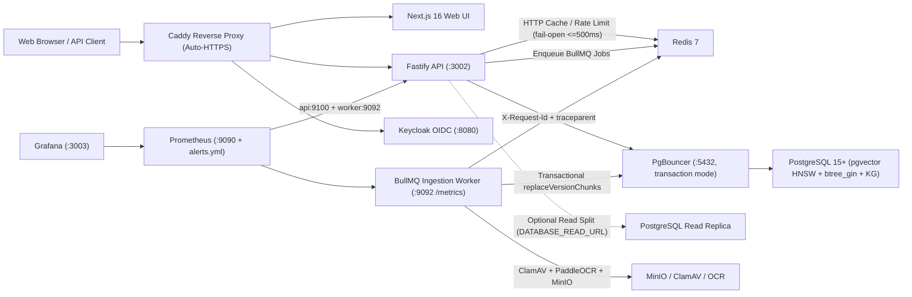
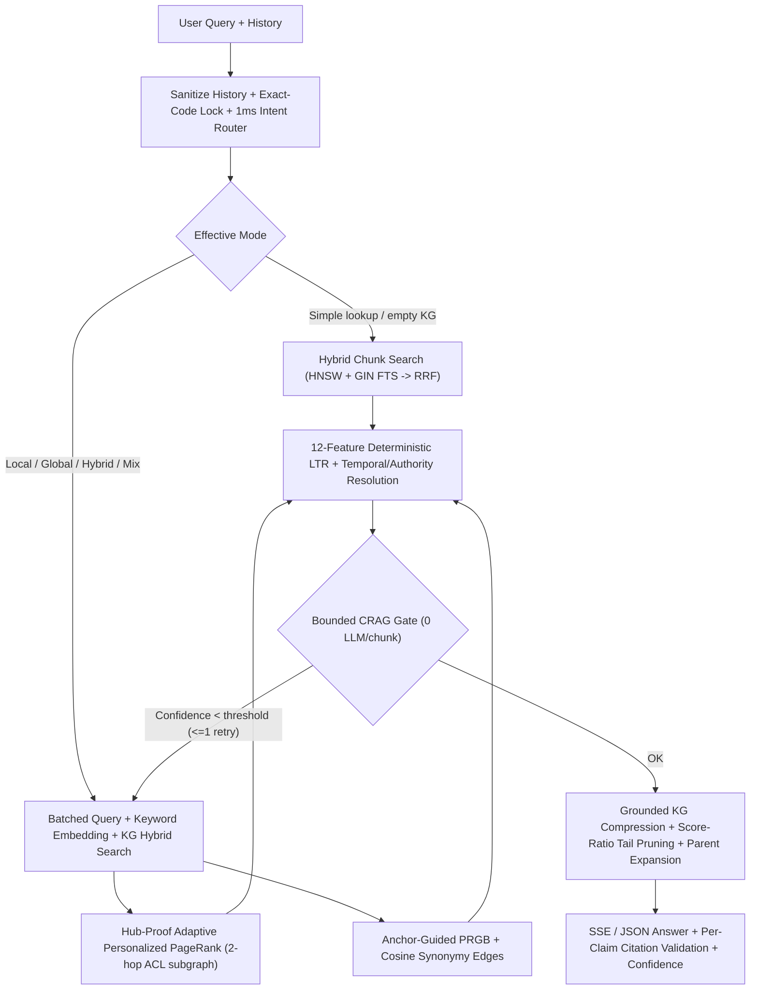
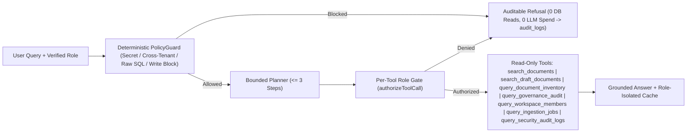

# System Architecture — ArkhiveRAG

ArkhiveRAG is an open-source, multi-tenant **Bring-Your-Own-Key (BYOK)** enterprise RAG platform built around **one primary database stack (PostgreSQL 15+ with `pgvector`, `pg_trgm`, `btree_gin`, and stored `tsvector`) + Redis + MinIO + Keycloak**. No separate vector database or graph database cluster is required.

---

## 1. High-Level Deployment Topology

---

## 2. Core Design Principles

1. **Single Transactional Source of Truth:** Document chunks (`vector(1024)` + `content_tsv`), Knowledge Graph entities/relations/aliases, RAPTOR community summaries, governance metadata, and learning telemetry live in PostgreSQL. Tenant isolation, ACL filtering, versioning, and backups share one ACID boundary.
2. **Fail-Open Edge / Fail-Closed Security:**
   - **Redis cache & rate-limit connection** (`backend/api/src/queue.ts`) uses `enableOfflineQueue: false`, `maxRetriesPerRequest: 1`, and `commandTimeout: 500ms` so Redis stalls degrade cache gracefully in `<= 511 ms` instead of blocking HTTP chat routes.
   - **Multi-tenant & document-ACL enforcement** is **fail-closed in SQL** before any ranking or context assembly.
3. **Database Performance Without Hardware Bloat (`100k` Docs Tested):**
   - **HNSW Raw Distance Ordering:** All dense vector queries (`ChunkRepository`, `KnowledgeGraphRepository`, `CommunityRepository`) execute inside a two-stage CTE ordered by `ORDER BY embedding <=> $vec::vector ASC` (with `SET LOCAL hnsw.ef_search` and automatic `hnsw.iterative_scan` probing on `pgvector >= 0.8`), never `ORDER BY (1 - (embedding <=> vec)) DESC`.
   - **Lean Wire Projections:** Retrieval `SELECT`s explicitly exclude `embedding` (`4–12 KB` per chunk) and `content_tsv`, slashing Postgres-to-Node wire payload by ~85%.
   - **Tenant-Scoped Composite `btree_gin` FTS:** Migration `0015` consolidates chunk full-text indexing onto a single partial index `idx_chunks_org_content_tsv_gin` on `(org_id, content_tsv) WHERE is_active = true AND chunk_role <> 'parent'`, eliminating redundant GIN write amplification.
   - **PgBouncer + Read-Replica Split + Singleflight:** `packages/database/src/client.ts` auto-disables prepared statements (`prepare: false`) in transaction pooling mode (`DATABASE_POOLER_MODE=transaction` or port `:6432`), routes read repositories to optional `DATABASE_READ_URL`, caches `hasGraphData(orgId)` for 30s, and coalesces identical concurrent tenant/ACL-scoped hybrid searches via `SingleflightGroup`.

---

## 3. Adaptive Retrieval Pipeline (`LightRagRetriever`)

### Closed-Loop `RetrievalLearningEngine`
- **Plane 1 (`< 5 ms` online):** Reads versioned `retrieval_configs` (cached in Redis) per organization.
- **Plane 2 (`async` shadow):** Runs non-intrusive shadow candidate strategies on a configured sample (`SHADOW_SAMPLE_RATE`) with zero generation LLM calls.
- **Plane 3 (`POST /api/v1/retrieval/optimize`):** Applies bounded L2-regularized weight updates only if candidate weights pass a **6-metric regression gate** (NDCG, Recall, Faithfulness, `p95` latency, `<= +5%` tokens, `0` ACL leaks). Immutable configs support 1-call rollback via `POST /api/v1/retrieval/configs/:id/promote`.

---

## 4. Crash-Safe Document Ingestion Lifecycle (`@rag/worker`)

1. **Upload & Enqueue (`POST /api/v1/documents/upload`):** Streams file to MinIO, creates DB record + `document_versions` row inside a Postgres transaction, and enqueues BullMQ job (`attempts: 3`, exponential backoff). If queue submission fails, upload rolls back storage/DB cleanly (`503`).
2. **Startup Stale Reconciler:** On worker boot, orphaned `processing` rows older than the configured stale threshold are safely reconciled.
3. **Processing Pipeline:**
   - Optional **ClamAV** virus scan (`ENABLE_VIRUS_SCAN=true` required in production)
   - Text/Markdown/HTML/PDF/Office extraction + **PaddleOCR** fallback
   - Structure- & i18n-aware **Parent-Child Recursive Chunking** + content-hash embedding deduplication
   - Optional **Knowledge Graph** entity/relation extraction (`kg_indexed_hash` skips unchanged docs in `O(1)`)
   - **Atomic Chunk Commit (`ChunkRepository.replaceVersionChunks`):** Deletes partial rows from any interrupted attempt for `(orgId, documentId, versionId)`, inserts parents + linked children, and deactivates prior versions in **one Postgres transaction** — guaranteeing `0` duplicate chunks even after a mid-ingestion `SIGKILL`.

---

## 5. Multi-Tenant & Governance Security Invariants

| Layer | Enforcement |
| :--- | :--- |
| **Authentication** | Keycloak OIDC RS256 JWT verification (`packages/auth`), JWKS cached locally. |
| **RBAC (`packages/auth/src/rbac.ts`)** | `owner`, `admin`, `member` (own-doc mutate), `viewer` (read & chat only). |
| **SQL Isolation** | Every query in `ChunkRepository`, `KnowledgeGraphRepository`, and `CommunityRepository` mandates `orgId` (`requireTenant`) and optional `documentIds` ACL arrays; RAPTOR enforces `kg_communities.document_ids <@ allowed_document_ids`. |
| **Governance Lifecycle** | `draft`, `approved`, `active`, `superseded`, `archived` via `PATCH /api/v1/documents/:id/governance`. Drafts and archived docs are excluded from standard retrieval by default. |
| **Immediate Revocation** | Role/membership removals or library deletion increment Redis `rag:acl-version:<orgId>` & `rag:cache-version:<orgId>` to invalidate cached responses immediately. |
| **Production Safety Guard** | `assertProductionConfig()` refuses API/worker startup when `NODE_ENV=production` has weak defaults (`postgres`, `minioadmin`), missing HTTPS Keycloak URL, `*` CORS, missing provider credentials, or `ENABLE_VIRUS_SCAN=false`. |

---

## 6. V3.1 RBAC-Enforced Company Agent (`CompanyAgentOrchestrator`)

Above the adaptive retrieval engine, V3.1 adds an optional **RBAC-enforced Company Agent** (`POST /api/v1/agent/query` or `agentic: true` on `POST /api/v1/chat/completions`) that decides per query whether to search documents, query allowlisted read-only PostgreSQL tools, combine both (`<= 3` hops), answer directly, or fail-closed refuse out-of-authority requests:

- **Zero Raw LLM SQL:** Structured DB tools live exclusively in `AgentToolsRepository` (`readDb`, hard `limit <= 50`, `requireTenant(orgId)`).
- **Role-Isolated Caching:** Chat completions in `agentic: true` mode include `agent:<role>` in `queryHash` so restricted roles never inherit cached admin/owner structured outputs.
